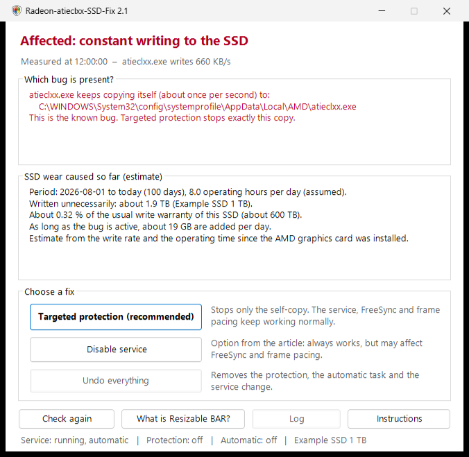
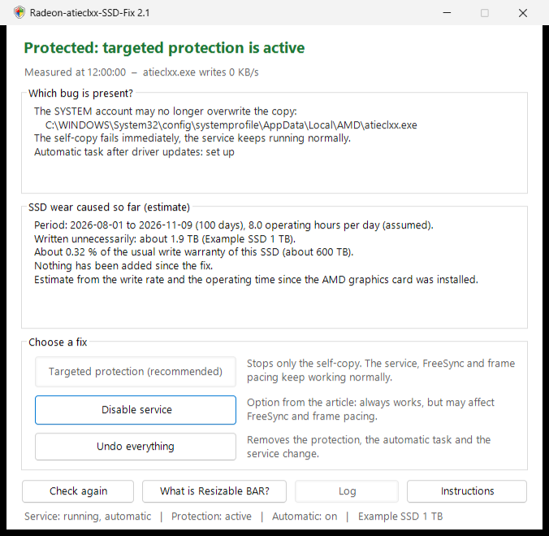

# Radeon-atieclxx-SSD-Fix

**English:** [English version below](#english-version)

**Der Radeon-Treiber schreibt fortwährend auf deine SSD?** Bei betroffenen Treibern kopiert sich `atieclxx.exe` (Dienst „AMD External Events Utility“) jede Sekunde selbst – rund 56 GB pro Tag. Dieses Programm prüft, ob dein PC betroffen ist, schätzt den bisherigen Schaden und stoppt das Dauerschreiben gezielt, ohne den Dienst abzuschalten.

> **Hinweis:** Inoffizieller Workaround, nicht von AMD und ohne Verbindung zu AMD. Nutzung auf eigene Verantwortung, ohne Gewährleistung und ohne Haftung (siehe [LICENSE.txt](LICENSE.txt)).


*Beispielansicht, alle Werte sind Beispielwerte.*

## Das Problem

ComputerBase berichtete am 09.11.2026, dass der Dienst „AMD External Events Utility“ des Radeon-Treibers bei vielen Nutzern fortwährend auf das Systemlaufwerk schreibt ([Artikel](https://www.computerbase.de/news/grafikkarten/schnelle-ssd-alterung-radeon-treiber-schreibt-fortwaehrend-daten-auf-die-ssd.100237/)). AMD hat den Fehler bestätigt, eine korrigierte Treiberversion gibt es noch nicht.

Mit der Windows-Ereignisablaufverfolgung (ETW) nachgemessen: Bei betroffenen Treibern kopiert sich `atieclxx.exe` **jede Sekunde selbst** aus dem Treiberordner nach

```
C:\Windows\System32\config\systemprofile\AppData\Local\AMD\atieclxx.exe
```

Die Datei ist rund 660 KB groß, das sind im Dauerbetrieb etwa 56 GB pro Tag. Danach sucht der Dienst nach Installationsdateien des Filtertreibers `amdkmpfd` (Smart Access Memory). Das erklärt, warum manchen das Abschalten von Resizable BAR hilft.

## Download und Start

1. Unter [**Releases**](../../releases/latest) die Datei `Radeon-atieclxx-SSD-Fix.zip` herunterladen.
2. Die ZIP-Datei vollständig entpacken.
3. `START.cmd` doppelklicken und die Windows-Abfrage nach Administratorrechten mit „Ja“ bestätigen.

Falls Windows warnt („Der Computer wurde durch Windows geschützt“): „Weitere Informationen“ → „Trotzdem ausführen“. Oder vor dem Entpacken die ZIP-Datei mit Rechtsklick → Eigenschaften → „Zulassen“ freigeben.

## Was das Programm macht

- **Analyse:** misst, ob und wie stark `atieclxx.exe` schreibt, und zeigt, welche Variante vorliegt: Selbstkopie an die bekannte Stelle, Schreiben an einer anderen Stelle oder nicht betroffen.
- **Schadensschätzung:** wie viel bereits unnötig auf die SSD geschrieben wurde (Schreibrate × Betriebszeit seit der Installation der AMD-Grafik) und welcher Anteil der üblichen Schreib-Garantie das ist.
- **Fix-Knöpfe:**

| Knopf | Wirkung |
|---|---|
| **Gezielter Schutz** (empfohlen) | Verbietet nur dem Konto SYSTEM, diese eine Kopie zu überschreiben. Der Kopierversuch scheitert sofort, es wird nichts mehr geschrieben. Dienst, FreeSync, Frame Pacing und Hotkeys bleiben unberührt. Richtet zusätzlich eine Automatik ein (siehe unten). |
| **Dienst deaktivieren** | Die Variante aus dem Artikel. Wirkt immer, kann aber FreeSync und Frame Pacing beeinträchtigen. |
| **Alles rückgängig** | Nimmt Schutz, Automatik und Dienst-Deaktivierung zurück. |

Die dritte Möglichkeit aus dem Artikel, Resizable BAR im BIOS abzuschalten, erklärt das Programm. Umsetzen lässt sie sich nur im BIOS.


*Zustand nach dem gezielten Schutz, ebenfalls mit Beispielwerten.*

### Automatik nach Treiber-Updates

Der gezielte Schutz richtet die Aufgabe „Radeon-atieclxx-SSD-Fix“ in der Aufgabenplanung ein. Sie läuft als SYSTEM 3 Minuten nach dem Start und danach alle 30 Minuten und

- setzt den Schutz neu, wenn ein Treiber-Update die Datei ersetzt hat,
- prüft nach einem Treiberwechsel selbst, ob AMD den Fehler behoben hat, und hebt den Schutz dann von allein auf,
- schreibt nur bei Ereignissen ins Protokoll `C:\Program Files\Radeon-atieclxx-SSD-Fix\protokoll.txt`.

## Technische Details

- Schutz: `icacls <Kopie> /deny *S-1-5-18:(WD,AD,WEA,WA,DE)`, also ein Verweigern-Eintrag nur für das Konto SYSTEM auf genau diese eine Datei.
- Die Selbstkopie wird über die USN des NTFS-Änderungsjournals erkannt (`FSCTL_READ_FILE_USN_DATA`). Zeitstempel taugen dafür nicht, weil `CopyFile` sie von der Quelle übernimmt. Als Rückfallebene ermittelt eine kurze ETW-Aufzeichnung (höchstens 64 MB, wird sofort gelöscht), wohin geschrieben wird.
- Die Messung läuft im Hintergrund, das Fenster bleibt bedienbar.
- Keine Downloads, keine Internetverbindung, keine Änderung am Treiber, keine AMD-Dateien im Paket. Der gesamte Quelltext liegt im Ordner [`Skript`](Skript).

## Status prüfen und entfernen

| Datei | Zweck |
|---|---|
| `PRUEFEN.cmd` | Status und 10-Sekunden-Messung, ohne Adminrechte |
| `ENTFERNEN.cmd` | nimmt alles zurück und löscht den Programmordner |

Nach dem gezielten Schutz liegen beide auch in `C:\Program Files\Radeon-atieclxx-SSD-Fix`.

## Alternative ohne dieses Programm

`Win+R` → `services.msc` → „AMD External Events Utility“ → Beenden, Starttyp „Deaktiviert“. Das ist der Vorschlag aus dem Artikel; er kann FreeSync und Frame Pacing beeinträchtigen.

## Grenzen

- Andere Treiberversionen können sich anders verhalten. Das Programm misst deshalb vorher und greift nur ein, wenn der Fix wirkt.
- Die Schadensschätzung ist eine Schätzung. Viele SSDs geben ihre Betriebsstunden nicht an Windows weiter, dann wird mit 8 Stunden pro Tag gerechnet.
- Auf PCs, auf denen per Firmenrichtlinie nur signierte PowerShell-Skripte erlaubt sind, startet das Programm nicht.
- Unter Windows Home gibt es keine Hinweisfenster der Automatik (`msg.exe` fehlt dort). Alles steht trotzdem im Protokoll.

## Lizenz und Marken

MIT-Lizenz, siehe [LICENSE.txt](LICENSE.txt). AMD, Radeon und Smart Access Memory sind Marken der Advanced Micro Devices, Inc. Dieses Projekt steht in keiner Verbindung zu AMD und wird von AMD weder unterstützt noch geprüft.

---

## English version

**Is the Radeon driver constantly writing to your SSD?** With affected drivers, `atieclxx.exe` (service "AMD External Events Utility") copies itself every second – about 56 GB per day. This program checks whether your PC is affected, estimates the damage so far and stops the constant writing in a targeted way, without turning off the service.

> **Note:** Unofficial workaround, not made by AMD and not affiliated with AMD. Use at your own risk, without warranty and without liability (see [LICENSE.txt](LICENSE.txt)).



*Example view, all values are example values.*

### The problem

On 2026-11-09, ComputerBase reported that the "AMD External Events Utility" service of the Radeon driver keeps writing to the system drive for many users ([article](https://www.computerbase.de/news/grafikkarten/schnelle-ssd-alterung-radeon-treiber-schreibt-fortwaehrend-daten-auf-die-ssd.100237/)). AMD has confirmed the bug, a fixed driver version is not available yet.

Measured with Windows event tracing (ETW): with affected drivers, `atieclxx.exe` copies itself **every second** from the driver folder to

```
C:\Windows\System32\config\systemprofile\AppData\Local\AMD\atieclxx.exe
```

The file is about 660 KB, which adds up to about 56 GB per day in continuous operation. After that, the service looks for installation files of the filter driver `amdkmpfd` (Smart Access Memory). This explains why turning off Resizable BAR helps some people.

### Download and start

1. Under [**Releases**](../../releases/latest), download the file `Radeon-atieclxx-SSD-Fix-English.zip`.
2. Extract the ZIP file completely.
3. Double-click `START.cmd` and confirm the Windows prompt for administrator rights with "Yes".

If Windows shows a warning ("Windows protected your PC"): "More info" → "Run anyway". Or, before extracting, right-click the ZIP file → Properties → "Unblock".

### What the program does

- **Analysis:** measures whether and how much `atieclxx.exe` writes and shows which variant is present: self-copy to the known location, writing to another location, or not affected.
- **Damage estimate:** how much has already been written to the SSD unnecessarily (write rate × operating time since the AMD graphics card was installed) and what share of the usual write warranty that is.
- **Fix buttons:**

| Button | Effect |
|---|---|
| **Targeted protection** (recommended) | Denies only the SYSTEM account overwriting this one copy. The copy attempt fails immediately, nothing is written any more. Service, FreeSync, frame pacing and hotkeys are not affected. Also sets up an automatic task (see below). |
| **Disable service** | The option from the article. Always works, but may affect FreeSync and frame pacing. |
| **Undo everything** | Removes the protection, the automatic task and the disabled service. |

The third option from the article, turning off Resizable BAR in the BIOS, is explained by the program. It can only be done in the BIOS.



*State after targeted protection, also with example values.*

#### Automatic task after driver updates

Targeted protection sets up the task "Radeon-atieclxx-SSD-Fix" in Task Scheduler. It runs as SYSTEM 3 minutes after startup and then every 30 minutes and

- applies the protection again if a driver update has replaced the file,
- after a driver change, checks by itself whether AMD has fixed the bug, and then removes the protection on its own,
- only writes to the log `C:\Program Files\Radeon-atieclxx-SSD-Fix\log.txt` when something happens.

### Technical details

- Protection: `icacls <copy> /deny *S-1-5-18:(WD,AD,WEA,WA,DE)`, i.e. a deny entry only for the SYSTEM account on exactly this one file.
- The self-copy is detected via the USN of the NTFS change journal (`FSCTL_READ_FILE_USN_DATA`). Timestamps are useless for this, because `CopyFile` takes them over from the source. As a fallback, a short ETW trace (at most 64 MB, deleted immediately) determines where the writes go.
- The measurement runs in the background, the window stays usable.
- No downloads, no internet connection, no change to the driver, no AMD files in the package. The complete source code is in the folder [`english/Script`](english/Script).

### Check status and remove

| File | Purpose |
|---|---|
| `CHECK.cmd` | status and 10-second measurement, without administrator rights |
| `REMOVE.cmd` | undoes everything and deletes the program folder |

After targeted protection, both are also in `C:\Program Files\Radeon-atieclxx-SSD-Fix`.

### Alternative without this program

`Win+R` → `services.msc` → "AMD External Events Utility" → Stop, startup type "Disabled". This is the suggestion from the article; it may affect FreeSync and frame pacing.

### Limitations

- Other driver versions may behave differently. The program therefore measures first and only acts if the fix works.
- The damage estimate is an estimate. Many SSDs do not report their operating hours to Windows; then 8 hours per day are assumed.
- On PCs where company policy only allows signed PowerShell scripts, the program does not start.
- On Windows Home there are no pop-up messages from the automatic task (`msg.exe` is missing there). Everything is still written to the log.

### License and trademarks

MIT license, see [LICENSE.txt](LICENSE.txt). AMD, Radeon and Smart Access Memory are trademarks of Advanced Micro Devices, Inc. This project is not affiliated with AMD and is neither endorsed nor reviewed by AMD.
